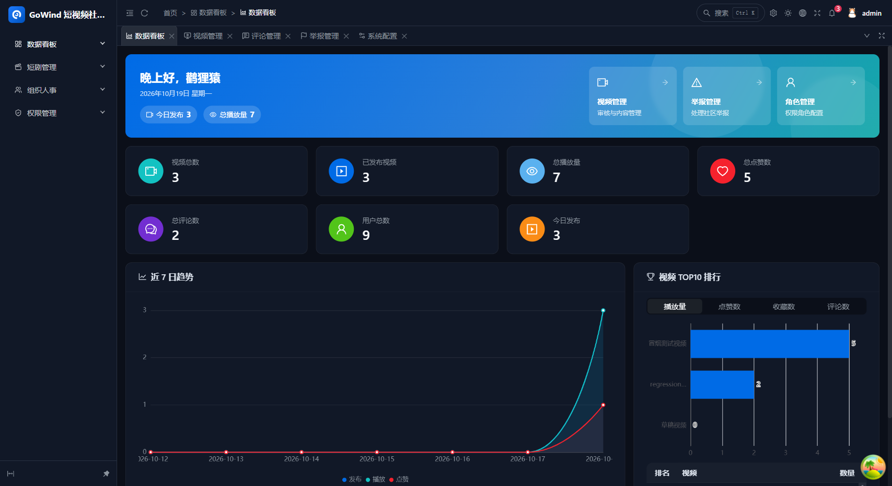
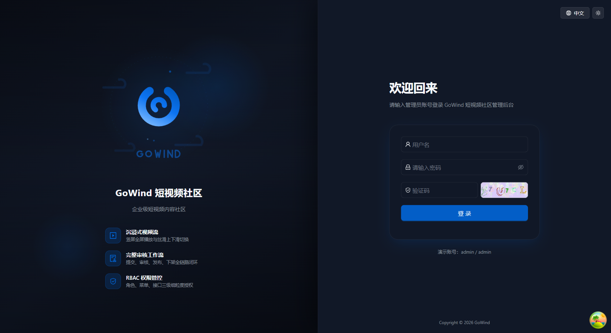
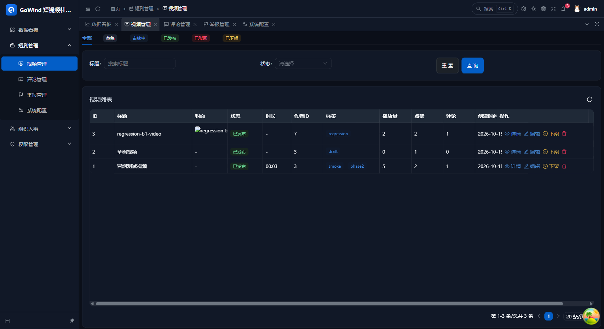
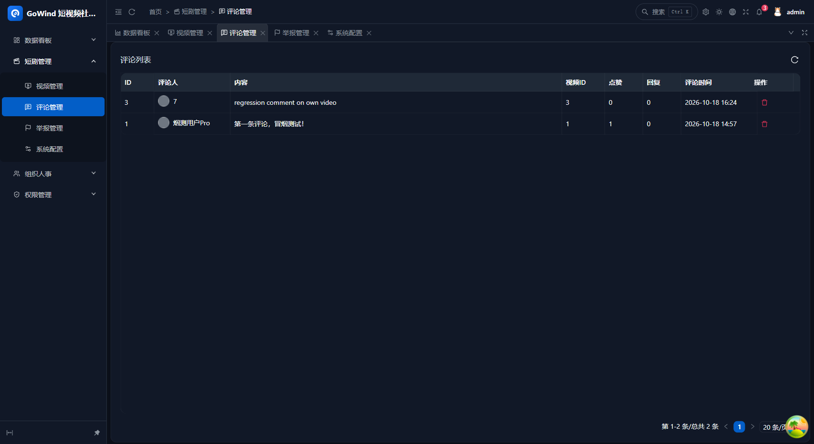
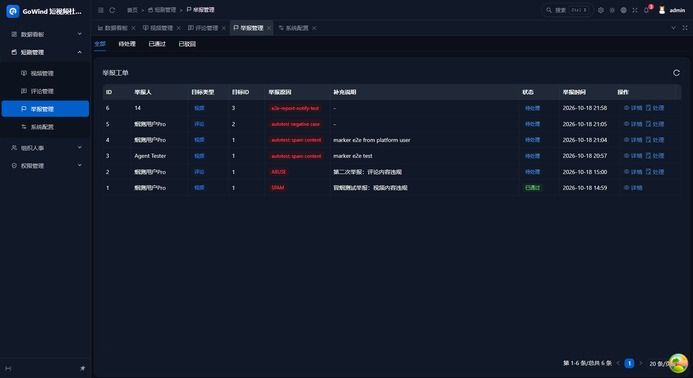
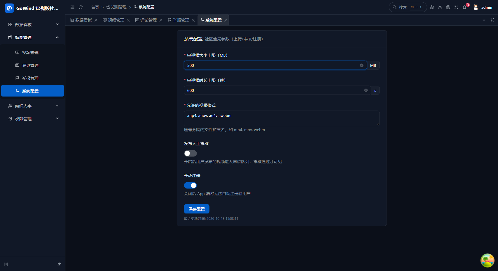
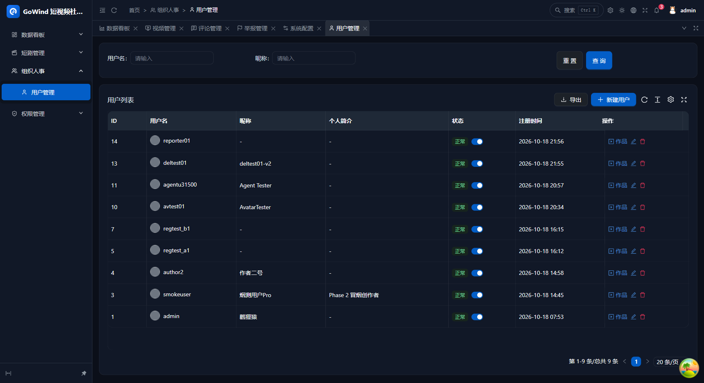
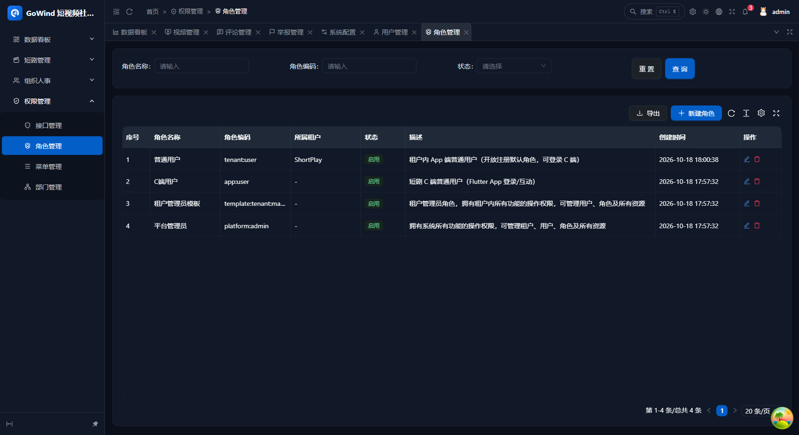
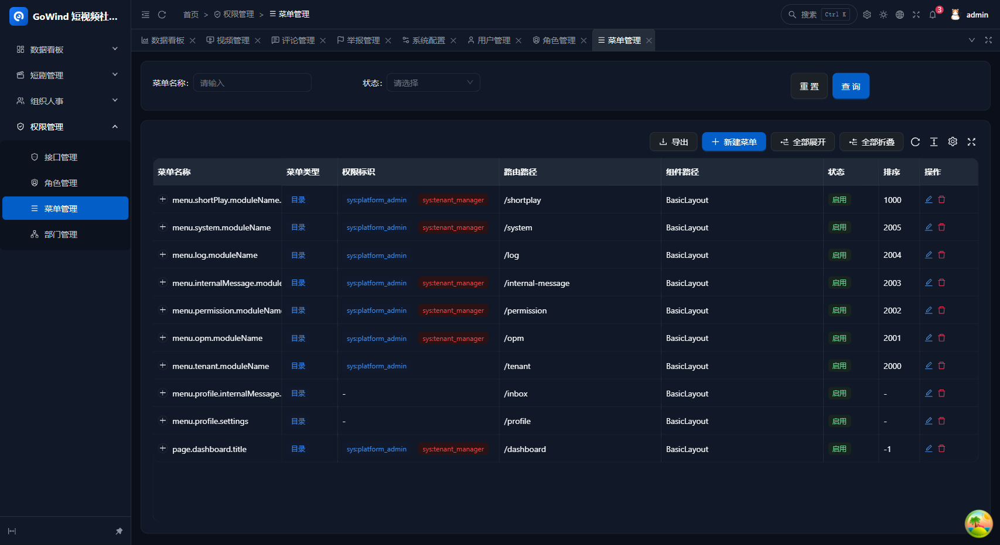

<div align="center">

# GoWind ShortPlay

[](./LICENSE)
[](https://go.dev/)
[](https://react.dev/)
[](https://flutter.dev/)
[](https://go-kratos.dev/)

**English** | [中文](./README.md) | [日本語](./README.ja-JP.md)

</div>

---

<div align="center">
  
  <p><sub>Admin Console · Dashboard (React 19 + Ant Design, based on GoWind Admin)</sub></p>
</div>

GoWind ShortPlay is an out-of-the-box, enterprise-grade short-video community base edition (open-source MVP) built on the GoWind ecosystem: immersive vertical-swipe video feed, publishing, social interactions, and a back-office review loop — ready to deploy for small-traffic, in-enterprise scenarios.

**Highlights:**

- **API First** — Protobuf-first contract-driven development, RESTful / gRPC dual protocol, OpenAPI docs auto-generated (`make openapi`; the per-service Swagger UI is off by default and can be enabled in configs)
- **Three-Service Architecture** — thin admin / app BFF gateways + one core service as the single data sink, isomorphic to [go-wind-cms](https://github.com/tx7do/go-wind-cms)
- **Two Frontends** — React 19 admin panel (trimmed from the GoWind Admin base) + Flutter cross-platform app, sharing a single core service
- **Out of the Box** — one-command `docker compose`; core auto-creates tables and seeds the admin account on first start
- **Room for the Pro Edition** — transcoding cluster, AI recommendation, content moderation, SaaS multi-tenancy, and live streaming attach as external services; contract boundaries are already in place (see [docs/ROADMAP.md](./docs/ROADMAP.md))

> **Open-source / Pro edition boundary**: this repository is the open-source base edition. It does not include a multi-bitrate transcoding cluster, AI recommendation, content moderation, SaaS multi-tenancy, or live streaming (reserved for the commercial closed-source add-on pack).

## Screenshots

| | | |
|---|---|---|
|  |  |  |
|  |  |  |
|  |  |  |

> More: API management, departments under `docs/images/`; Flutter App (iOS/Android/Windows) and H5 share page screenshots ship with each release.

## Tech Stack

### Backend

| Layer | Technology | Notes |
|:------|:-----------|:------|
| Language | [Go 1.26+](https://go.dev/) | High-performance compiled language |
| Framework | [go-kratos](https://go-kratos.dev/) v2.9 | Microservice framework by Bilibili |
| Dependency Injection | Hand-written wiring (wiring.go) | No DI framework |
| ORM | [Ent](https://entgo.io/) v0.14 | Schema as code |
| Database | [PostgreSQL](https://www.postgresql.org/) / [MySQL](https://www.mysql.com/) | Dual support, pgx/v5 driver |
| Cache | [Redis](https://redis.io/) | Counters / watched-filter / feed dedup |
| Object Storage | [MinIO](https://min.io/) | Videos / covers (S3-compatible) |
| Media Processing | FFmpeg | Single-frame cover extraction, in-process, silent fallback when missing |
| API Definition | [Protobuf](https://protobuf.dev/) + [buf.build](https://buf.build/) | Contract-first |
| Authentication | HS256 JWT | Issued by core, verified at gateways, propagated via gRPC metadata |

### Admin Frontend

| Technology | Notes |
|:-----------|:------|
| [React 19](https://react.dev/) + [TypeScript](https://www.typescriptlang.org/) | Modern frontend framework + type safety |
| [Ant Design](https://ant.design/) + [ProComponents](https://procomponents.ant.design/) | Enterprise admin UI (Ant Design Pro v6) |
| [TanStack Query](https://tanstack.com/query) | Server-state management |
| Build Tool | [Vite](https://vite.dev/) 8 (requires Node ≥ 20.19) |

> The admin panel is trimmed and adapted from the Ant Design Pro base of go-wind-cms: the shell and infrastructure (layout / routing / auth / i18n / transport layer) are preserved, and short-video community modules are added following the base's existing patterns.

### Mobile App

| Technology | Notes |
|:-----------|:------|
| [Flutter](https://flutter.dev/) 3.x | One codebase for both iOS and Android |
| [BLoC](https://bloclibrary.dev/) | State management |
| [media_kit](https://media-kit.pro/) | Video player (immersive vertical swipe) |

## Architecture

```
React Admin ──▶ admin-service (BFF :7600, SSE :7601) ──┐
                                                       ├──gRPC──▶ core-service (:7900, single data sink)
Flutter App ──▶ app-service   (BFF :7700) ─────────────┘              │
                                            PostgreSQL / Redis / MinIO / FFmpeg
```

- **admin / app are thin BFF gateways** (parameter validation + forwarding); all business logic and data operations converge in core
- Domain separation lives in protos and core's internal modules (business domains video / feed / report / sysconf / uba + base infrastructure domains identity / permission / authentication / comment / interaction / notify / stats), not in processes
- See [docs/ROADMAP.md](./docs/ROADMAP.md) for the service-splitting analysis and the Pro edition expansion path

### Ports

| Port | Service | Notes |
|---|---|---|
| :7600 | admin BFF (REST) | Admin API (Swagger at `/docs/` requires `enable_swagger` in configs, off by default) |
| :7601 | admin BFF (SSE) | Real-time notifications at `/events` (requires `?stream=<accessToken>` matching the Bearer token) |
| :7700 | app BFF (REST) | Flutter app API (Swagger same as above, off by default) |
| :7701 | app BFF (SSE) | App-side SSE channel `/events` (reserved; not consumed by the app yet) |
| :7900 | core (gRPC) | Single data sink, registered in etcd |
| :16800 | admin frontend dev server | Vite (`frontend/admin`); backend CORS whitelist allows `localhost:16800` by default |
| :9000 | MinIO S3 API | Object storage public reads (media URL prefix, `OSS_PUBLIC_ENDPOINT`) |
| :8280 | ZLMediaKit HTTP | Local streaming media (reserved for live/transcoding extensions, mapped via `docker run`) |

## Core Features

### Video & Feed

| Feature | Description |
|:--------|:------------|
| Video publishing | Chunked upload (resumable-friendly), merge into MinIO, FFmpeg cover extraction, drafts |
| State machine | Draft → Review → Published / Rejected → Offline, whitelist-validated transitions |
| Immersive feed | Vertical swipe, three-way rule-based recall (followed-newest / hot-weighted / newest fallback), Redis watched-dedup |
| Search & aggregation | Fuzzy title + exact tag search, tag aggregation pages, tag list (for publishing / search suggestions) |

### Interaction & Community

| Feature | Description |
|:--------|:------------|
| Likes / Favorites | Like videos and comments, favorite videos |
| Follows | Follow / fan lists, personal profile |
| Comments | Video comments (nested-reply fields reserved) |
| Notifications | Like / comment / follower / system notifications |
| Report loop | User report tickets; approval triggers handling of the target content (offline / delete) |
| UBA tracking | Watch / completion / swipe-away events feeding feed ranking |
| Creator stats | Works / likes received / followers and more |
| Sharing | Share H5 landing page |

### Admin Panel

| Feature | Description |
|:--------|:------------|
| Video management | Review / reject / offline / delete with visible state transitions |
| Comment management | Comment query and deletion |
| Report tickets | Report handling linked to target content |
| User management | User query and administration |
| Dashboard | Key metrics overview + video TOP10 ranking + 7-day trends |
| System settings | Upload limits / duration limits / manual-review switch |

## Project Structure

```
go-wind-shortplay/
├── backend/                        # Backend services
│   ├── api/                        # Protobuf API definitions & generated code
│   │   ├── protos/                 # .proto sources (video/feed/interaction/... domains + admin/app BFF)
│   │   └── gen/go/                 # Generated code (HTTP/gRPC/validation), do not edit
│   ├── app/
│   │   ├── admin/service/          # Admin panel service (BFF, REST :7600)
│   │   ├── app/service/            # Client app service (BFF, REST :7700)
│   │   └── core/service/           # Core business service (logic + data layer, gRPC :7900)
│   ├── pkg/                        # Shared packages (auth context/middleware/OSS/service discovery...)
│   ├── Makefile / app.mk           # Build orchestration
│   └── docker-compose.yaml         # Containerized deployment (three app services)
├── frontend/
│   ├── admin/                      # Admin panel frontend (React 19 + Ant Design Pro v6, dev :16800)
│   └── app/                        # Flutter app (BLoC + media_kit)
└── docs/                           # Docs (API contract digest, architecture decisions)
```

## Quick Start

### Prerequisites

- Go 1.26+
- Docker & Docker Compose
- Node.js ≥ 20.19 & pnpm (required by Vite 8)
- Flutter 3.x
- buf (Protobuf toolchain; installed automatically by `make init`)

### 1. Prepare Dependency Services

PostgreSQL / Redis / MinIO / etcd are reused from existing containers on the host; ZLMediaKit is created separately via `docker run`, and the `shortplay` database must be created in PostgreSQL:

```bash
docker run -d --name shortplay-zlmediakit --restart unless-stopped \
  -p 8280:80 -p 8444:443 -p 8555:554 -p 8935:1935 -p 8200:8000/udp -p 11001:10000 \
  -v shortplay_zlm_data:/opt/media/bin/data \
  zlmediakit/zlmediakit:master
```

```sql
CREATE DATABASE shortplay;
```

### 2. Configure Environment Variables

```bash
cd backend
cp .env.example .env    # fill in your local PostgreSQL / Redis / MinIO connection values (.env is gitignored)
```

`.env` is picked up automatically by `make run` (via app.mk) and by docker compose; `${VAR:default}` placeholders in each service's `configs/*.yaml` resolve with "environment variable first, default as fallback" (defaults are placeholder strings — you **must** supply real values in `.env` to reach the dependencies). For production, inject via the deployment environment instead; never commit real credentials.

### 3. Initialize and Start the Backend

```bash
cd backend
make init        # First time: install protoc plugins and CLI toolchain

make gen         # ent + api + openapi in one command
cd app/core/service  && make run   # gRPC :7900 (auto-creates tables and seeds the admin account)
cd app/admin/service && make run   # REST :7600
cd app/app/service   && make run   # REST :7700
```

Smoke test (login passwords travel AES-encrypted; the ciphertext below equals `demo123` encrypted with the dev default key — if you change `AES_KEY`, recompute it with the algorithm in `frontend/admin/src/utils/crypto.ts`):

```bash
curl -X POST http://127.0.0.1:7700/app/v1/auth/register \
  -H 'Content-Type: application/json' \
  -d '{"username":"demo","password":"SjM/2yeJT+/3xpCGydysrA==","nickname":"Demo"}'
```

API docs: the OpenAPI assets are generated by `make openapi` into `app/{admin,app}/service/assets/openapi.yaml`. To browse the Swagger UI, set `server.rest.enable_swagger` to `true` in the corresponding service's configs and restart (off by default; `/docs/` returns 404).

### 4. Start the Frontends

```bash
# Admin panel
cd frontend/admin
pnpm install
pnpm dev         # dev :16800; demo account admin / admin (seeded on first core start)

# Flutter app
cd frontend/app
flutter pub get
flutter run --dart-define=API_BASE=http://127.0.0.1:7700   # Android emulator defaults to 10.0.2.2
```

> Guest boundary: feed / video detail / search / profiles / comment lists are accessible to guests (the app silently downgrades on 401); publishing / liking / commenting / following require login; the admin panel requires login everywhere.

## Known Limitations (Open-Source Base Edition)

- **Single-bitrate passthrough**: no transcoding cluster; videos play as uploaded (the Pro edition adds multi-bitrate transcoding + content moderation)
- **Notifications are in-app only**: admin SSE (:7601) real-time push + app-side polling; no email / SMS / push channels
- **Manual review**: the review loop is manual; no machine moderation
- **Feed ranking**: three-way rule-based recall with weighted scoring, not model ranking
- **Frontend AES key**: the dev default for login password transport encryption is the public base default (local only); in production rotate it on both ends (`AES_KEY` / `VITE_AES_KEY`)
- **Bring your own dependencies**: PostgreSQL / Redis / MinIO / etcd instances must be provisioned by you (containers or managed); this repo does not orchestrate them

### Common Commands

```bash
cd backend

make init        # Install protoc plugins and CLIs (first time)
make api         # buf generate (proto → Go)
make openapi     # Generate admin/app OpenAPI docs into assets/
make ent         # Generate ent code (per service)
make gen         # ent + api + openapi in one command
make build       # Build all services
make test        # go test ./...
make lint        # golangci-lint
```

### Containerized Deployment

```bash
cd backend
docker compose up -d --build
```

> For more development workflows, see the [backend development guide](./backend/AGENTS.md).

## Docs

- Root README (trilingual): [README.md](./README.md) / [README.en-US.md](./README.en-US.md) / [README.ja-JP.md](./README.ja-JP.md)
- Backend development guide: [backend/AGENTS.md](./backend/AGENTS.md) — for AI coding tools and human contributors alike
- Admin panel: [frontend/admin/AGENTS.md](./frontend/admin/AGENTS.md)
- Flutter app: [frontend/app/AGENTS.md](./frontend/app/AGENTS.md)
- REST API contract digest: [docs/API.md](./docs/API.md)
- Architecture decisions & service-splitting analysis: [docs/ROADMAP.md](./docs/ROADMAP.md)
- Syncing upstream changes from the base: [docs/UPSTREAM.md](./docs/UPSTREAM.md)

## Contact

- WeChat: `yang_lin_bo` (remark: `go-wind-shortplay`)

## Contributing

Contributions of all kinds are welcome, including but not limited to:

- Opening an [Issue](../../issues) to report bugs or suggest features
- Opening a [Pull Request](../../pulls) to fix issues or add features
- Improving docs and translations
- Sharing your experience

See [CONTRIBUTING.md](./CONTRIBUTING.md) for details.

## License

This project is licensed under the [MIT License](./LICENSE).

## Acknowledgements

[](https://jb.gg/OpenSource)

Thanks to [JetBrains](https://jb.gg/OpenSource) for providing free GoLand & WebStorm open-source licenses.
